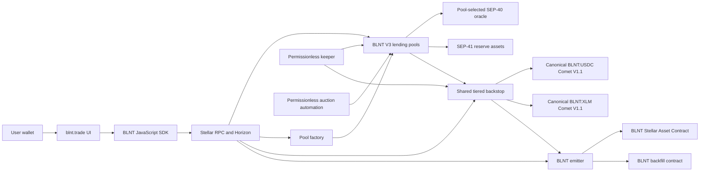
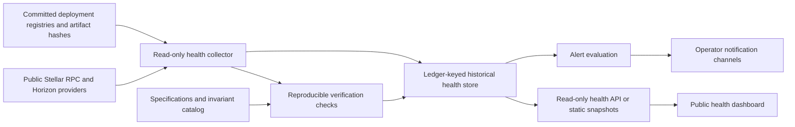
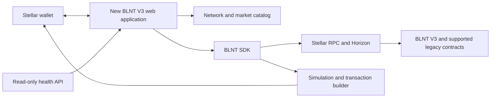

# BLNT V3 SCF #46 Technical Architecture

| Field | Value |
| --- | --- |
| Status | Proposed architecture for SCF #46 |
| Scope | Planned SCF #46 improvements to the deployed BLNT V3 system |
| Network | Stellar mainnet and public testnet |

## 1. Purpose

BLNT V3 is an immutable lending protocol derived from Blend and designed to
support real-world assets and other issuer-controlled Stellar assets. The
protocol is already deployed on Stellar mainnet. The proposed SCF work does
not retroactively modify those contracts. It adds audit-readiness and health
tooling, replaces the current user interface with an RWA-aware experience, and
produces a separately identified BLNT V4 release candidate on public testnet.

This document describes that work at the system level. It is intentionally a
companion to, rather than a replacement for, the normative specifications:

- [BLNT V3 Contract Specification](https://github.com/BLNT-Protocol/blnt-contracts-v3/blob/main/docs/V3_SYSTEM_SPEC.md)
  defines the exact deployed V3 behavior.
- [Migration and Deployment System Specification](SYSTEM_SPEC.md) defines
  source, artifact, compatibility, and deployment authority.
- [Token and Emitter Transition Specification](MIGRATION_PROTOCOL_SPEC.md)
  defines BLNT issuance, canonical liquidity, legacy isolation, and future
  protocol replacement.
- [Mainnet V3 Deployment](MAINNET_V3_DEPLOYMENT.md) and the committed
  registries under `blnt-contracts-v3/deployments/` record the deployed
  contracts, artifacts, bindings, and transactions.

If this architecture overview conflicts with those specifications or the
deployed artifacts, the specifications and deployed artifacts control.

## 2. Architectural goals

The funded work is designed around six goals:

1. Preserve the immutable BLNT V3 mainnet artifacts and make their exact scope
   easier for independent reviewers to reproduce.
2. Expose protocol health from public Stellar data without introducing an
   operator capable of changing lending state.
3. Give BLNT V3 markets a distinct, accessible user experience that clearly
   communicates issuer controls and RWA-specific behavior.
4. Keep transaction authorization in the user's Stellar wallet and submit
   transactions directly to Stellar.
5. Develop V4 as a separately specified and deployed testnet candidate rather
   than presenting changed WASM as BLNT V3.
6. Preserve permissionless lending pools and bound any proposed V4 guardrail
   by an explicit authority model, failure behavior, and executable tests.

## 3. Deployed BLNT V3 architecture

### 3.1 Implementation stack

- **Smart contracts:** Rust 1.91.1, Soroban SDK 27.0.3, Stellar Protocol 27,
  and optimized `wasm32v1-none` artifacts with release overflow checks.
- **Canonical liquidity:** official Comet V1.1 release WASM for the 80:20
  BLNT:USDC and BLNT:XLM pools.
- **Client SDK:** TypeScript using Stellar SDK 16 for RPC reads, contract
  simulation, transaction construction, and result decoding.
- **Web application:** Next.js 15, React 18, TypeScript, Material UI, React
  Query, and Stellar wallet integrations. These are the current client
  foundations; the Tranche 2 implementation may upgrade a dependency through
  ordinary reviewed release work.
- **Automation:** Node 22 auction tooling plus shell, Node, Stellar CLI, and
  Rust-based deployment and verification runners.
- **Network data:** Stellar RPC for Soroban state and simulation, Horizon for
  account and classic-asset data where appropriate, and ledger events for
  historical protocol activity.

Exact versions and dependency integrity are controlled by the relevant
workspace manifests and lockfiles rather than this overview.

### 3.2 System topology

The browser interface and SDK construct transactions but do not custody user
assets or hold protocol authority. A connected wallet authorizes user actions.
Stellar validators execute the contracts atomically, and public RPC responses
provide the state used by clients. Keepers and auction automation invoke
permissionless maintenance and auction entry points; their availability does
not grant them ownership of protocol funds.

### 3.3 On-chain components

| Component | Current responsibility | Authority boundary |
| --- | --- | --- |
| Pool factory | Deploys and registers pools with immutable backstop-tier configuration | Cannot rewrite an already deployed pool's WASM or tier configuration |
| Lending pool | Tracks reserves, supplier and borrower positions, interest, health, auctions, emissions, and pool-local configuration | A transferable pool administrator retains only the bounded V2-compatible pool controls documented by the V3 specification |
| Shared backstop | Accounts for zero to three loss tiers per pool, queued withdrawals, loss absorption, interest donations, reward-zone membership, and depositor emissions | Accepts only the configured canonical tier assets; it is not a protocol governor |
| BLNT emitter | Mints one BLNT per elapsed second to the current backstop and retains the economic replacement path | Has no ongoing administrator, emergency override, or privileged WASM upgrade path |
| BLNT Stellar Asset Contract | Represents the BLNT asset | The emitter is its administrator; the classic issuer account is locked |
| Canonical Comet V1.1 pools | Provide the BLNT:USDC and BLNT:XLM LP assets used by canonical backstop tiers and current-reserve valuation | Use the official Comet V1.1 release WASM and locked controller configuration |
| Backfill contract | Custodies the immutable initial BLNT allocation, claims, contributor grants, and bounded BLND-to-BLNT conversion | Cannot mint BLNT or alter allocations after construction |
| Pool oracle | Prices lending reserves for health, liquidation, and auction accounting | External availability and correctness remain explicit pool dependencies |
| Reserve assets | Provide SEP-41 custody and transfer behavior; Stellar Asset Contracts may also expose issuer authorization and clawback | Issuer controls remain asset-specific and are not converted into protocol-wide authority |

### 3.4 Lending and RWA transaction flow

1. The UI reads pool, reserve, oracle, backstop, and user state through the SDK
   and public Stellar endpoints.
2. The SDK builds a bounded request batch for supply, collateral, withdrawal,
   borrow, repay, liquidation, or flash-loan behavior.
3. The wallet displays and authorizes the transaction.
4. Stellar simulation prepares the Soroban footprint and resource fee; the
   signed transaction is then submitted to the network.
5. The pool checks authorization, oracle freshness, utilization, position
   health, reserve configuration, exact custody deltas, and numeric bounds.
6. All state and token changes succeed atomically or the entire transaction
   rolls back.

V3 supports permissioned pools and issuer-controlled reserve assets. For
Stellar Asset Contract reserves it recognizes current authorization state,
fails closed on prohibited token transfers, removes deauthorized collateral
from effective health, and retains debt and accounting rather than silently
forgiving it. An authorized issuer may invoke the specified pool clawback path
for a clawback-enabled reserve. Generic SEP-41 assets remain subject to the
token implementation's truthfulness and transfer semantics.

### 3.5 Backstop, auctions, and emissions flow

Each pool selects zero to three immutable backstop tiers. Supported V3 tier
assets are canonical BLNT:XLM LP, canonical BLNT:USDC LP, USDC, and XLM. The
configured order defines the loss waterfall, while separate weights influence
interest allocation. Only the two canonical BLNT LP tiers are eligible for
BLNT emissions.

Borrower interest is divided between suppliers, configured backstop tiers,
and the immutable protocol-interest fee. Permissionless interest auctions sell
accrued reserve interest for the selected backstop asset and donate the bid to
that tier. Independent protocol-fee auctions sell protocol credit for BLNT and
burn the BLNT bid. Bad debt first consumes configured backstop tiers in order
before the inherited supplier-loss path becomes available.

The emitter sends BLNT to the shared backstop. Backstop checkpoints divide it
between backstop depositors and pool supply/borrow programs. Pool and tier
gulps convert pending allocations into seven-day streams. Claims are
owner-authorized, and the backstop compounds a depositor's BLNT into the same
canonical LP tier through a single-sided Comet V1.1 deposit.

### 3.6 Legacy isolation and future replacement

Legacy Blend positions, BLND, and legacy emitter state remain outside BLNT V3.
The V3 emitter is a separate BLNT emitter. It retains a permissionless,
economically qualified 31-day backstop replacement mechanism for a future
protocol version; it does not provide an administrator-controlled upgrade.
The proposed SCF work does not alter legacy positions or claim an upgrade of an
official Blend deployment.

## 4. Off-chain components and trust boundaries

| Boundary | Design treatment |
| --- | --- |
| Browser and UI | Untrusted presentation layer. It may construct requests but cannot sign for the user. Important state is read from public Stellar data. |
| Wallet | User authorization boundary. The user reviews and signs transactions. Secrets never enter the public dashboard or repository. |
| SDK | Deterministic client integration layer for reads, transaction construction, and result decoding. Contract checks remain authoritative. |
| Stellar RPC and Horizon | Public data and transaction transport. Responses may be stale, unavailable, or inconsistent; clients expose freshness and retry different providers where appropriate. |
| Pool oracle | Economic input selected by each pool. Stale or invalid values fail closed for price-dependent operations. |
| Reserve issuer | May retain authorization or clawback powers for an RWA or other issued asset. Those powers must be disclosed per reserve. |
| Pool administrator | Pool-local configuration authority only. It cannot upgrade V3 contracts, change immutable backstop tiers, or govern the protocol. |
| Keepers and auction bots | Permissionless automation. Other callers can perform the same protocol actions, and failure must not create privileged state. |
| Comet V1.1 reserve composition | Current canonical LP composition is an accepted valuation dependency for V3 backstop accounting and BLNT pricing. |
| Deployment and release evidence | Exact commits, optimized WASM hashes, constructor bindings, transactions, and network registries define reproducible artifact identity. |

## 5. Proposed SCF architecture

The following components are future deliverables. They do not describe
already deployed V3 behavior.

### 5.1 Tranche 1: audit readiness and protocol health

The collector will use only public reads. It will not hold signing keys or
submit state-changing protocol transactions. Every observation will identify
its network, contract, ledger, capture time, source endpoint, and freshness.
The historical store is a diagnostic cache, not protocol authority; the
dashboard will distinguish fresh, stale, unavailable, and failed checks.

Planned checks include:

- deployed contract and WASM identity against committed registries;
- constructor bindings and canonical asset or Comet V1.1 relationships;
- pool status, reserves, utilization, oracle freshness, and custody;
- backstop tiers, queued-withdrawal ratios, reward-zone state, and emissions;
- pending and active interest, protocol-fee, liquidation, and bad-debt
  auctions;
- keeper checkpoints, TTL condition, RPC health, and observable liveness; and
- mainnet/testnet separation and source-verification links.

The audit-readiness package will connect this observable topology to a dataflow
diagram, STRIDE threat model, invariant and integration-test evidence,
self-service security scan, dependency and artifact manifest, findings
register, and remediation plan. Audit invoices and an auditor's schedule are
outside this architecture and the requested Build budget.

### 5.2 Tranche 2: new RWA-aware UI and SDK integration

The new application will make BLNT V3 visually and semantically distinct from
legacy Blend markets. Its primary flows cover discovery, portfolio state,
supply, withdrawal, borrowing, repayment, collateral, backstop positions,
queued withdrawals, emissions, claims, auctions, and actionable failures.

For issuer-controlled and RWA markets, the market model will expose:

- reserve contract and asset type;
- permission or access-controller requirements;
- current reserve authorization state where available;
- issuer clawback capability and the pool's supported clawback behavior;
- oracle identity, price age, and stale or unavailable state; and
- relevant pool, reserve, utilization, and backstop configuration.

Historical health data may improve presentation, but transaction construction
will refresh authoritative state through public Stellar endpoints. The health
service cannot authorize a transaction, change a quote, or override contract
validation. Automated end-to-end tests will exercise principal flows on public
testnet, while responsive-layout and accessibility tests cover supported
desktop and mobile experiences.

### 5.3 Tranche 3: BLNT V4 release candidate on public testnet

V4 will be a separate protocol candidate with its own specification, source
commit, artifacts, contract addresses, and deployment registry. V3 mainnet
WASM will remain unchanged. The release candidate will preserve V3's separate
pool factory, lending pool, shared backstop, emitter compatibility, canonical
artifact evidence, and atomic settlement model unless a documented security
requirement explicitly changes a boundary.

The candidate architecture will address these defined workstreams:

1. **Non-BLNT queued-withdrawal behavior.** Specify and test status and
   withdrawal behavior for backstop tiers that do not participate in BLNT
   emissions, including zero, stale, deauthorized, and impaired valuation.
2. **Configurable backstop valuation.** Define a bounded, oracle-backed way to
   value additional backstop assets without relying on caller-supplied values.
   The design must specify oracle identity, decimal normalization, freshness,
   failure behavior, and whether configuration is immutable or subject to a
   narrowly bounded pool-local authority.
3. **Additional issuer-controlled RWA requirements.** Incorporate findings from
   the V3 threat model and test authorization, clawback, transfer restrictions,
   custody loss, oracle interruption, and recovery behavior.
4. **Risk guardrails and circuit breakers.** Evaluate per-reserve borrow caps
   and other narrowly scoped mechanisms. Any adopted mechanism must document
   who can configure it, its bounds, activation and recovery behavior, and its
   failure modes. Evaluation alone does not imply that every mechanism will be
   included.
5. **Security findings.** Incorporate accepted material findings available
   before the V4 release-candidate scope is frozen, with regression tests and
   explicit migration consequences.

The V4 candidate will be deployed only to public testnet under this tranche.
Acceptance requires source-verifiable optimized WASM, reproducible deployment,
example pools, SDK support, compatibility and migration tests, failure-mode
tests, operator documentation, and a residual-risk register. A V4 mainnet
deployment, emitter migration, independent audit completion, or approval by
independent protocol participants is not an SCF tranche acceptance condition.

### 5.4 Scope exclusions

The proposed architecture does not include:

- modifying or redeploying the immutable BLNT V3 mainnet contracts;
- deploying V4 to mainnet or executing an emitter migration;
- treating a third-party audit or its timing as a Build deliverable;
- creating protocol governance, a treasury, or a privileged upgrade path;
- custodying user wallet keys or routing transactions through a trusted
  signing service;
- migrating or rewriting legacy Blend positions; or
- claiming an RWA issuer partnership that does not exist.

## 6. Data and state model

Authoritative financial state remains on Stellar. The proposed off-chain
systems may retain only derived data needed for historical analysis, health
status, alerting, and user experience.

| Data | Authoritative source | Proposed derived representation |
| --- | --- | --- |
| User positions and balances | Pool, token, backstop, and allowance contract state | Short-lived UI state keyed by network, contract, account, and ledger |
| Pool configuration and reserves | Pool contract and factory | Indexed market catalog with source ledger and contract IDs |
| Prices and freshness | Pool-selected oracle | Display model containing value, timestamp, validity, and failure state |
| Backstop and emissions | Backstop and emitter | Tier-aware health snapshots and historical series |
| Auctions | Pool contract state and contract events | Searchable current and historical auction views |
| Artifact identity | Committed registries plus on-chain WASM | Pass/fail verification evidence with expected and observed hashes |
| Operational health | Public RPC reads and check results | Ledger-keyed time series, alerts, and availability summaries |

No derived database may be used as the final source for transaction amounts or
authorization. Transaction preparation refreshes the required on-chain state,
and the contracts independently enforce all safety conditions.

## 7. Failure and recovery model

- **RPC or Horizon failure:** the UI and collector report unavailable or stale
  data, use bounded retries or alternate configured providers, and do not label
  cached state as current.
- **Oracle outage or stale price:** price-dependent contract operations fail
  closed according to the pool specification. Health tooling surfaces the
  affected oracle, pools, reserves, and last valid observation.
- **Keeper interruption:** permissionless operations remain callable by other
  participants. The dashboard reports delayed checkpoints and resulting state.
- **Auction automation interruption:** auctions remain contract-governed and
  permissionless; the bot is not a required authority.
- **Issuer deauthorization:** affected Stellar Asset Contract reserves or
  backstop value follow the documented quarantine and fail-closed behavior.
- **UI or health-service compromise:** the attacker cannot sign for users or
  rewrite protocol state. Wallet review and contract validation remain the
  transaction boundary.
- **Material V3 contract finding:** immutable V3 artifacts are not patched in
  place. Evidence is preserved, bounded mitigations are documented, and a
  separately identified candidate and migration path are prepared under the
  [immutable security response](IMMUTABLE_SECURITY_RESPONSE.md).
- **V4 testnet failure:** the candidate is corrected and redeployed under new
  recorded artifacts; no V3 mainnet state changes as a consequence.

## 8. Verification and delivery

Each release will be tied to public evidence:

| Tranche | Verifiable architecture outcome |
| --- | --- |
| 1 | A clean checkout reproduces artifact checks, audit-scope evidence, health collection, and dashboard state without signing credentials. |
| 2 | Reviewers exercise principal user flows on public testnet, reproduce displayed state from documented RPC reads, and clearly distinguish BLNT V3 from legacy Blend markets. |
| 3 | A clean checkout builds and tests the V4 release candidate, verifies its artifacts and constructor bindings, reproduces its public-testnet deployment, and exercises the defined RWA, backstop, oracle, guardrail, and compatibility scenarios. |

All project-built production or release-candidate WASM follows the repository's
[deployment-readiness gate](CONTRACT_DEPLOYMENT_READINESS.md): canonical source
metadata, a tagged source commit, release-built and attested artifacts, verified
constructor bindings, exact network records, and post-deployment evidence.
Private signing material, contributor manifests, account configuration, and
service credentials are excluded from repositories, logs, dashboards, and
submission artifacts.

## 9. Repository map

| Path | Role |
| --- | --- |
| `blnt-contracts-v3/` | Deployed immutable V3 contract source and normative behavior |
| `blnt-sdk-js/` | Client reads, models, and transaction construction |
| `blnt-ui/` | Current production interface and starting point for the replacement UI/UX |
| `auctioneer-bot/` | Permissionless auction automation |
| `blnt-backfill-contract/` | Initial BLNT claims, grants, and bounded legacy conversion |
| `comet-contracts-v1/` | Pinned upstream Comet V1.1 source reference |
| `migration-harness/` | Cross-version and deployed-WASM compatibility tests |
| `deployments/` and `blnt-contracts-v3/deployments/` | Network deployment and artifact registries |
| `docs/` | Architecture, migration, deployment, security-response, and acceptance documentation |

The health tooling, replacement UI/UX, and V4 candidate will be assigned
separate source and artifact boundaries before implementation so that none can
silently redefine deployed BLNT V3 behavior.
